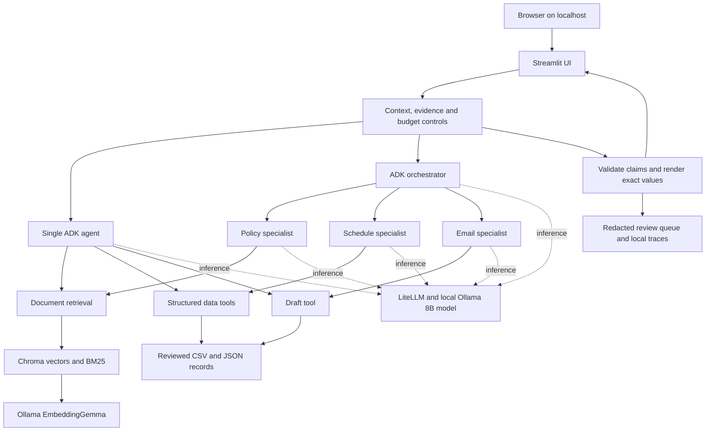

# Academic Helpdesk

Local Streamlit helpdesk built from the supplied IIT Jodhpur academic exports. The originals in `data/private_import` are preserved. Academic data, original documents, indexes, sessions, drafts, evaluation evidence and traces are excluded from Git. No account credentials or cloud model key is needed. Email is draft-only.

Run everything from this project folder. Python 3.12 is used because it is already installed; installed dependency versions are recorded in `requirements.lock`. Models are the explicit exception to project-local storage: `F:\Ollama\models`.

## Verification status

| Check | Recorded result |
|---|---|
| Automated backend/loader/privacy/tool contracts | 29 tests passed |
| Real Ollama model probes | Both 8B models made the required tool call; EmbeddingGemma produced 768-dimensional vectors |
| Actual ADK integration | Four cases passed per model/mode profile: schedule, document evidence, email draft and compound request. Focused rechecks retain audited prior passing cases. |
| Screenshot prerequisite regression | Both models returned the complete field with a citation tied to the requested course |
| Offline Streamlit components | All five pages, context reset, conversation retention, New chat and editable drafts passed with zero exceptions; API/model responses are mocked in this component test |
| Real and synthetic data checks | 1,733 REAL vectors and 6 isolated DEMO vectors; real retrieval and structured lookups passed |
| Original-source audit | All 28 supplied originals unchanged |
| Full experimental comparison | **360 planned trials are not completed.** Earlier interrupted pilots are diagnostic; human gold adjudication and scoring remain pending. |

These checks do not establish factual accuracy for every possible question or guarantee a grade. Browser visual inspection was unavailable through the local-origin permission gate; the native service and offline components were checked separately. [FINDINGS.md](report/FINDINGS.md) records the actual evidence, measured latency and remaining source gaps.

## Objectives and assignment scope

Build a local academic assistant that answers from the supplied academic documents, resolves structured course information, and prepares academic email drafts for review. The project compares a single-agent baseline with a multiagent implementation using the same local models and evidence tools.

The assignment objectives are:

1. Ingest real permitted exports, including scanned pages and workbook tabs, while preserving the original files.
2. Retain document versions, applicability metadata, page/sheet/row locators and source hashes.
3. Run local document embeddings and hybrid retrieval over approved evidence.
4. Answer policies/course-content questions with inspectable citations and use exact tables for schedules, instructors, counts and overlaps.
5. Implement genuine Google ADK agents through LiteLLM and Ollama, with bounded execution and minimal session memory.
6. Prepare editable, review-only email drafts, explicitly identifying missing contacts or student details.
7. Record unavailable, conflicting and unsupported questions for human review.
8. Provide a usable local UI, reproducible Windows setup, meaningful model checks and an honest evaluation package.
9. Compare 30 frozen questions across two models, two modes and three seeds, keeping raw results and separating automated checks from human judgments.

The supplied technical design is the implementation specification. Academic documents are evidence, not executable instructions. The project does not invent missing institutional rules or present an unexecuted benchmark as a successful result. See [design coverage](report/DESIGN-COVERAGE.md), [measured findings](report/FINDINGS.md) and [submission guide](SUBMISSION.md).

## Required behavior and constraints

| Area | Behavior |
|---|---|
| Academic facts | Use approved, applicable documents or exact source-backed records. Cite document/page or worksheet/row provenance. |
| Missing or conflicting evidence | Ask for essential context or return an explicit refusal/clarification; record the gap. Never guess a replacement course, contact or policy. |
| Programme and cohort | Require confirmed applicability for programme-specific requirements. A student name is not a programme. |
| Counts | Count distinct documented offerings only when completeness and explicit classifications have been verified. Never infer a level from code digits. |
| Emails | Draft, edit, copy and download only. There is no sending API or Send button. Preserve unknown values as placeholders. |
| Student facts | Use information supplied in the request; do not invent illness, approval, dates or identity. |
| Privacy | Keep originals, working copies, indexes, sessions, raw evaluations and private evidence outside Git. |
| Runtime | Bind services to localhost. Use the requested Ollama models. Install project dependencies/caches locally; model weights use the explicitly requested F: directory. |
| Experiments | Retain actual outputs, failures, seeds/settings and provenance. Human accuracy/groundedness metrics remain unverified until scored. |
| Dataset isolation | REAL and DEMO have separate data, indexes, state and results. Never silently substitute synthetic evidence. |

## Architecture



**Baseline:** one `LlmAgent` with all approved tools. **Multiagent:** an orchestrator delegates through `AgentTool` wrappers to policy, schedule and email specialists. A shared lock serializes specialist execution. Both modes use the same model allowlist, source snapshot and data tools; no scripted response is substituted for a measured LLM call.

### Request flow

1. Validate model/mode/context, dataset and immutable active-snapshot fingerprint. Apply scope and known evidence-gap guards.
2. Resolve only bounded prior course/topic context within the same dataset, snapshot, settings and conversation. Context changes start a fresh conversation.
3. Acquire the shared inference lock and unload the alternative chat model when required. Use the selected 8B model through ADK/LiteLLM.
4. Run a real model-selected data tool or specialist. The first document search preserves the original user question so a rewritten query cannot drop the course name. One controlled search reformulation is allowed.
5. After evidence is returned, remove tool declarations for the answer-generation step and request a JSON schema containing returned evidence IDs and exact quotes. This avoids repeated tool loops in Ollama. Empty retrieval may reformulate once.
6. Validate IDs and quoted passages against returned evidence. Prerequisite requests focus on the explicit prerequisite field. Unsupported output is repaired once within the shared budget or refused.
7. Render exact structured tool values or validated source excerpts. ADK's supported `skip_summarization` can finish exact tables and drafts without another rewriting step; traces record these backend finalizations.
8. Save minimal conversation context and redacted unresolved-question records. Full model-output capture is explicit for smoke/evaluation runs.

### Ingestion and source lifecycle

`original export → SHA-256 deduplication → extraction/OCR → candidate snapshot → metadata/table review → approval → local embeddings/index → activation`

The active snapshot remains available when extraction/indexing fails. Editing an active source creates a detached candidate. Unknown authority, applicability, completeness, contacts and clock interpretations remain explicit. Source citations retain full backend provenance even when the UI groups identical excerpts into one card.

## Technology choices

| Component | Technology and purpose |
|---|---|
| Runtime | Native Windows, installed Python 3.12 and Git; project `.venv` |
| Agent framework | Google ADK `LlmAgent`, `Runner`, `AgentTool`, callbacks and in-memory agent sessions |
| Model adapter | LiteLLM native Ollama chat/function-tool path |
| Chat models | `qwen3:8b` and `llama3.1:8b`, official Ollama manifests, Q4_K_M |
| Embeddings | `embeddinggemma:300m`, local 768-dimensional vectors and task prefixes |
| Retrieval | Chroma cosine index, BM25 lexical ranking and reciprocal-rank fusion |
| UI | Streamlit, local CSS, black/grey theme and installed Segoe UI fonts |
| Extraction | PyMuPDF, python-docx, openpyxl, BeautifulSoup and Python email parsers |
| OCR | RapidOCR with ONNX Runtime and project-local assets |
| Data/state | Reviewed CSV/JSON snapshots and SQLite for sessions, traces and unresolved questions |
| Validation | pytest, Streamlit AppTest, real Ollama/ADK smoke checks, psutil memory samples and source SHA audits |

Exact installed versions are in `requirements.lock` and the private doctor report. `requirements.txt` lists direct dependencies; the lock is the tested Windows environment.

### Decisions and practical tradeoffs

- Use the already installed Python 3.12 instead of installing another runtime for the design's 3.11 preference.
- Keep the requested 8B weights. Chat currently uses six CPU threads after native GPU cold-start failures on the 4 GB laptop GPU; embeddings use four CPU threads. This favors stable execution but multi-step answers can take minutes.
- Cap the native host prompt cache at 512 MiB and run one chat model at a time. Other applications affect memory and latency.
- Combine dense and lexical retrieval without pretending a ranking score proves semantic correctness. Source applicability and human review remain separate.
- Render validated quotations and exact table values conservatively. Quote validation supports punctuation/spacing normalization and can correct a pointer only to another already-returned source containing the same quote.
- Manual local import is the supported document route. Optional Google OAuth synchronization is not implemented.
- Do not infer missing policy amendments, curriculum applicability, department completeness or course levels. These are documented data gaps, not fabricated answers.

## Repository layout

```text
app/                         Streamlit application and monochrome stylesheet
helpdesk/agents/             ADK baseline, orchestrator, specialists and budgets
helpdesk/importers/          Loaders, OCR, metadata, snapshots and workbook mappings
helpdesk/rag/                Embeddings, Chroma, BM25, fusion and index checks
helpdesk/tools/              Exact academic lookups and review-only drafts
helpdesk/service.py          Request flow, evidence validation, guards and final rendering
helpdesk/storage.py          Minimal sessions, redacted queue and local traces
helpdesk/evaluation*.py      Trial harness, provenance, comparisons and metrics
scripts/                     Setup support, checks, recovery and packaging
tests/                       Backend, loader, privacy and tool-contract tests
evaluation/matrix.yaml       Shared model/mode/seed/settings matrix
report/                      Design coverage and measured findings
Start.cmd / Start.ps1        Windows launcher
Setup.ps1                    Project setup, configured Ollama restart and model setup
requirements.lock            Tested resolved dependency versions
data/                        PRIVATE: originals, working copies, snapshots and indexes
evaluation/results/          PRIVATE: raw trials, metrics and scoring sheets
report/private/              PRIVATE: doctor, source audits and real smoke outputs
.cache/ / .venv/              LOCAL ONLY: caches, downloaded assets and environment
submission/                  LOCAL ONLY: separate code and private evidence archives
```

The GitHub checkout contains implementation and documentation. Private source material, a prebuilt environment, model weights and a prebuilt Chroma database are deliberately excluded. To reproduce the exact supplied corpus elsewhere, obtain the permitted private evidence package separately, restore/review its sources, and rebuild embeddings. The working local folder already contains those private assets.


## Start on Windows

Double-click `Start.cmd`, or use PowerShell:

```powershell
Set-Location 'F:\Academic helpdesk agent'
.\Start.ps1
```

UI: http://127.0.0.1:8501. Ollama API: http://127.0.0.1:11434. Both bind only to localhost. Close the browser to leave the service running; stop the project Streamlit process to stop the UI. The launcher starts Ollama only when its API is unavailable; a server previously started with another environment must be restarted before moving model storage.

## Setup / recovery

Python, Git and Ollama must already be installed. The validated local machine has 16 GB nominal RAM and a 4 GB laptop GPU. Allow about 11 GB for the three model downloads, plus project dependencies, caches and private source material. All commands below run from the project root.

```powershell
Set-Location 'F:\Academic helpdesk agent'
powershell -NoProfile -ExecutionPolicy Bypass -File .\Setup.ps1
```

`Setup.ps1` creates `.venv` when needed, installs the pinned dependencies with a project-local pip cache, sets `OLLAMA_MODELS=F:\Ollama\models` persistently for the Windows user, safely restarts the expected installed Ollama server with that setting, reuses/downloads all three models, prepares the local tokenizer cache and checks actual inference. It fails if a download or required inference probe is not verified. Finish active requests before rerunning setup because it restarts Ollama.

Model files are the explicit exception to project-local storage. Server logs, model-range recovery blocks, Python dependencies, OCR/tokenizer caches and source processing stay under this project. The launch scripts configure the runtime; `.env.example` documents settings and is not an automatically loaded cloud-key file.

For model-download recovery after the environment exists:

```powershell
.\.venv\Scripts\python.exe scripts/download_models.py
.\.venv\Scripts\python.exe -m helpdesk doctor --inference
```

The recovery downloader uses official manifests, resumes completed ranges, verifies complete SHA-256 digests and activates local manifests. Completed weights are reused. It does not create smaller substitutes for the requested models.

To inspect API availability without generating:

```powershell
Invoke-RestMethod http://127.0.0.1:11434/api/tags
Invoke-RestMethod http://127.0.0.1:8501/_stcore/health
```

API availability is separate from successful inference. Doctor records actual tool probes, embedding dimensions, model digests, installed dependencies, RAM, disk and persistent model-directory configuration. One chat model and the small CPU embedding model may co-reside. The service unloads the alternative chat model before use. Other applications affect latency and free RAM. Index/cache validity includes the exact embedding digest and task prefixes.

Start the UI with `Start.cmd` after importing/activating permitted sources and validating the profiles. On a fresh GitHub checkout, private academic documents, expected answers and indexes are absent. Use permitted exports or the separate private evidence package; review applicability and rebuild the index. Source/import pages remain accessible before chat readiness checks pass.

## Import and review

Place permitted exports in `data/private_import`, then use **Import & review**, or:

```powershell
.\.venv\Scripts\python.exe -m helpdesk ingest --dataset real --input data/private_import
```

The importer preserves originals and creates versioned private snapshots with SHA-256 deduplication, page/tab/cell locators, redacted extracted working copies, candidate workbook mappings and structured CSV/JSON tables. All workbook tabs are read. Scanned PDF pages use offline RapidOCR; OCR model assets live in `.cache/ocr`. EML plain-text/HTML message bodies and supported attachments are ingested; attachments retain their bytes and parent-message provenance and are deduplicated by hash. HTML/TXT, DOCX, CSV and XLSX are supported.

Inspect full extractions and mappings, confirm authority/URL or message identifier, applicability and completeness, and approve sources. Unknown metadata stays unknown. Review counts never include duplicates. Ambiguous or new workbook layouts can be mapped explicitly from canonical fields to column letters in the mapping editor. Then click **Build embeddings and activate**. Activation follows successful index construction; failed candidates preserve the last active snapshot. CLI equivalent after review:

```powershell
.\.venv\Scripts\python.exe -m helpdesk index --dataset real
```

Exact tables retain source row provenance. Do not infer level from a course code. Exact elective counts refuse until department completeness, course levels and categories have been verified. Multiple slots/instructors and missing contact details remain explicit. The imported `Safari.pdf` must not be assumed to be the student's curriculum just because it is present. The programme field in supplied setup notes contains a student name; programme remains unconfirmed.

## Chat and evidence

The monochrome chat page has a pinned composer, a narrow reading column and collapsible sources/response details. The sidebar opens Sources, Import & review, Review queue and Experiments as separate pages. **Chat settings** contains REAL/DEMO, baseline/multiagent, model, term, programme and cohort. New chat clears the conversation; changing context also resets it. The font uses installed Segoe UI fonts without external requests. Native Streamlit scrolling follows new output while allowing the reader to scroll back; CSS scrolling respects reduced-motion preferences. “This semester” refers to the displayed term. Demo never silently replaces real data. Each dataset has separate manifests, snapshots, index and SQLite state. The service enforces six data calls, three specialist calls, ten generations and a request timeout. ADK AgentTool specialists execute sequentially. Baseline uses the same data tools and model settings.

Answers are selected source excerpts with backend-validated returned IDs and exact quotes; this conservative rendering reduces unsupported paraphrases. It does not prove semantic relevance or applicability, which require human scoring. Unsupported answers abstain. No web fallback exists. Source documents are treated as evidence, never executable instructions. Original copies and excerpts are available in citation cards. Drafts are editable, downloadable and clearly marked for review; missing recipient/date/identity fields remain placeholders. No email sending capability exists.

## Tests and evaluation

```powershell
.\.venv\Scripts\python.exe -m pytest -q
.\.venv\Scripts\python.exe -m helpdesk ask 'What is the slot for Autonomous Systems?' --mode single
.\.venv\Scripts\python.exe -m helpdesk evaluate --dataset real --matrix evaluation/matrix.yaml
```

The frozen private question file contains 30 prompts and source-backed candidate gold evidence. Human verification is required before treating the gold set as adjudicated. Full matrix: 2 modes × 2 models × 30 prompts × 3 seeds = 360 trials. Raw outputs, latencies, model digests, snapshot, settings, memory samples, changed outputs and blank human scoring sheets are saved in `evaluation/results/<dataset>`. `--limit N` runs a clearly partial matrix. Unexecuted trials are counted as not_run; unscored accuracy/groundedness remain null. Status match is not accuracy. Report findings must not turn suggested targets into measured achievements.

Q14 runs Q13 as a recorded setup turn in the same session; the setup turn is not an additional scored trial. Timing records whether the selected chat model was resident immediately before the request. Scope/data guards may legitimately perform zero model calls. Both modes use the same backend controls and tools. Specialists are serialized even when the root proposes several tool calls together. Exact tool values/drafts can finish through ADK's supported `skip_summarization` path; traces record these backend finalizations separately. `model_outputs` in raw records contains ADK final content, including direct tool outputs when summarization was skipped.

After completing the human scoring CSV, recompute metrics with:

```powershell
.\.venv\Scripts\python.exe -m helpdesk.evaluation_metrics evaluation/results/real/<run>.jsonl --scoring evaluation/results/real/<run>.human-scoring.csv
```

## Runtime checks and troubleshooting

```powershell
.\.venv\Scripts\python.exe -m helpdesk verify-data --dataset real
.\.venv\Scripts\python.exe -m helpdesk smoke --model qwen3:8b --mode single
.\.venv\Scripts\python.exe -m helpdesk smoke --model qwen3:8b --mode multi
.\.venv\Scripts\python.exe -m helpdesk smoke --model llama3.1:8b --mode single
.\.venv\Scripts\python.exe -m helpdesk smoke --model llama3.1:8b --mode multi
```

Each successful four-case smoke check enables that model/mode's chat profile. Source review remains accessible while integration checks are pending. Refresh model status in the sidebar afterward. After changing backend code, restart the UI with `powershell -NoProfile -ExecutionPolicy Bypass -File scripts/restart_ui.ps1` to avoid stale imports; this restart script does not open a browser.

To force a previously passing policy case to run again, use `--case policy`. The same option supports schedule, email and compound cases. After a focused bug fix, add `--failed-only` to recheck failed smoke cases while retaining the same model/mode's prior passing checks. Reused records retain their responses and an audit pointer to the previous artifact; they are not new inference runs. Remove that flag for a completely fresh four-case check.

If a model download repeatedly resets, `python scripts/download_models.py` uses official registry manifests, resumable small ranges and final SHA-256 verification. It preserves completed blocks. Model weights live only under `F:\Ollama\models`. A missing tokenizer cache can be prepared with `python scripts/cache_tokenizer.py`; both `TIKTOKEN_CACHE_DIR` and LiteLLM's `CUSTOM_TIKTOKEN_CACHE_DIR` point inside the project. The native function-tool path disables the optional LiteLLM MCP gateway; no MCP server or cloud model credentials are required.

A filesystem lock prevents simultaneous UI and evaluation processes from generating with different chat models. Run the full evaluation while leaving chat idle. A busy/timeout response is logged as an infrastructure error. Local 8B inference can take minutes for multi-step questions; see the measured report rather than assuming desktop-chat response times.

Both 8B chat models currently run with `num_gpu=0` and six CPU threads because cold GPU runner starts on this 4 GB laptop GPU produced CUDA initialization failures. CPU embeddings use four threads. The model names and weights are unchanged; CPU latency is measured in the saved checks rather than estimated. Tool argument normalization handles numeric strings emitted by the local models, and invalid retrieval counts fall back to the bounded default.

The project launcher sets `LLAMA_ARG_CACHE_RAM=512` to cap the native runner's host prompt cache at 512 MiB. Before this cap, the cache was observed at over 4 GiB and free physical RAM approached 1 GiB on this laptop. The upstream [Ollama issue and workaround](https://github.com/ollama/ollama/issues/18264) explain this runner setting. `scripts/restart_ollama.ps1` applies it to the existing project server; finish or stop active requests before using that restart script. Model files and indexes are preserved.

See `SUBMISSION.md` for the demonstration checklist and separate local code/evidence archives. Private gold records, sources and raw results must not be committed to Git.

Human rubric: mark factual answer correct only if all required facts, exceptions and applicability are supported; refusals on answerable questions are incorrect. Count exact supported claims/citations and cited claims to compute groundedness, citation precision/coverage. Score email fields, recipient or explicit unknown placeholder, supplied facts and no approval promises. Distinguish changed wording from substantive changes. Inspect failures and compare Recall@k against frozen gold IDs.

## macOS / Linux portability

```bash
cd /path/to/project
python3 -m venv .venv
export PIP_CACHE_DIR="$PWD/.cache/pip"
.venv/bin/python -m pip install -r requirements.lock
export OLLAMA_MODELS="/chosen/model/directory"
export OLLAMA_HOST=127.0.0.1:11434
export OLLAMA_MAX_LOADED_MODELS=2
ollama serve
# Another shell:
ollama pull embeddinggemma:300m
ollama pull qwen3:8b
ollama pull llama3.1:8b
.venv/bin/python -m helpdesk doctor --inference
.venv/bin/python -m streamlit run app/main.py --server.address 127.0.0.1 --browser.gatherUsageStats false
```

The resolved lock was tested on Windows; platform-specific wheels may require re-resolving `requirements.txt` on other operating systems. Optional Google OAuth sync is not implemented; manual local import is the supported route.

## GitHub and private delivery

The repository contains application source, launch/setup scripts, dependency locks, tests and documentation. `.gitignore` excludes academic originals and extractions, indexes, model weights, environments, caches, sessions, drafts, private evaluation/gold data, logs, local archives and credentials. Do not force-add those excluded files.

The local `submission/Academic-Helpdesk-code.zip` and separately labelled private-evidence archive are generated with SHA manifests and ZIP integrity checks. Neither is uploaded by the application. Share private evidence only through the permitted assignment submission route. A source-only clone requires corpus restoration/review and embedding reconstruction before it can reproduce the local academic answers.

## Useful verification and maintenance commands

```powershell
# The actual screenshot question, including course-specific citation validation:
.\.venv\Scripts\python.exe scripts/check_course_regression.py --model qwen3:8b
.\.venv\Scripts\python.exe scripts/check_course_regression.py --model llama3.1:8b
# Separate synthetic data isolation check:
.\.venv\Scripts\python.exe -m helpdesk verify-data --dataset demo
# Regenerate the report from saved real checks, then local delivery archives:
.\.venv\Scripts\python.exe scripts/write_findings.py
.\.venv\Scripts\python.exe scripts/build_submission.py
```

The frozen question generator (`scripts/prepare_evaluation.py`) requires the reviewed corpus and private gold overrides. Run it only when intentionally preparing a new evaluation version; changing the frozen questions invalidates a resumed run. `scripts/render_gold.py` creates the private readable candidate-answer file. Human review is still required. Windows sleep/Modern Standby interrupts local inference; an interrupted request remains an infrastructure failure in the raw history and must be rerun, not relabelled as a successful answer.
